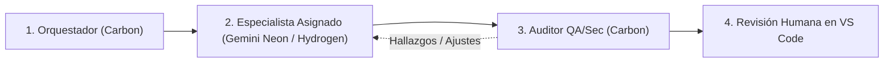

# Sistema Multi-Agente — `dian-ubl-lakehouse`

Este repositorio implementa un flujo de ingeniería asistido por IA gobernado en Markdown y ejecutado **exclusivamente con modelos Google Gemini** dentro de **Antigravity** y **VS Code**.

Todo agente que opere en este proyecto está sujeto de forma obligatoria e incondicional a las reglas definidas en [.agent/rules/global-standards.md](.agent/rules/global-standards.md), a la política de datos de [SECURITY.md](SECURITY.md) y a las decisiones arquitectónicas vigentes en [docs/adr/](docs/adr/).

---

## 1. Flujo de Trabajo Multi-Agente

Ningún desarrollo se ejecuta de manera aislada ni directa sobre `main`. Cada funcionalidad, ajuste o entregable recorre estrictamente **4 etapas secuenciales**:

1. **Inicio en el Orquestador (`00-orchestrator` — Modelo: `Carbon`):**
   - Recibe el hito o requerimiento, valida coherencia contra `README.md` y `docs/adr/`, descompone el alcance en tareas atómicas y define qué especialista debe actuar y qué modelo Gemini seleccionar en Antigravity.
2. **Ejecución con el Especialista Asignado (`01`, `02` o `04` — Modelos: `Gemini Neon` / `Gemini Hydrogen`):**
   - El especialista presenta **primero su plan técnico** (*Plan-First*) y espera confirmación explícita antes de crear o modificar archivos dentro de los límites estrictos de su rol.
3. **Compuerta del Auditor QA/Sec (`03-qa-sec-auditor` — Modelo: `Carbon`):**
   - Realiza revisión crítica del entregable, diseña/ejecuta pruebas con `pytest` y `dbt test`, valida casos borde contables/XML/TRM y audita que existan cero secretos hardcodeados y cero PII o facturas reales. Si detecta brechas, devuelve hallazgos accionables al especialista.
4. **Cierre con Revisión Humana en VS Code:**
   - El ingeniero responsable inspecciona el `git diff` en VS Code, aprueba los cambios verificados, realiza el commit siguiendo *Conventional Commits* en la rama activa e integra hacia `main` únicamente mediante **Pull Request**.

---

## 2. Catálogo de Agentes y Modelos Gemini

| Agente | Ruta de Archivo | Responsabilidad Principal | Modelo Gemini Asignado |
| :--- | :--- | :--- | :--- |
| **00 - Orquestador** | `.agent/agents/00-orchestrator.md` | Descompone hitos en tareas pequeñas, asigna qué agente debe actuar y qué modelo seleccionar en Antigravity, y verifica cumplimiento contra `README.md` y `docs/adr/`. | **Carbon** |
| **01 - Data Engineer** | `.agent/agents/01-data-engineer.md` | Generador XML UBL 2.1 sintético con casos borde, parser con Pydantic, cliente API TRM (`datos.gov.co`) e ingesta idempotente en Python. | **Gemini Neon** |
| **02 - dbt & BI Architect** | `.agent/agents/02-dbt-bi-architect.md` | Capas Medallion (Bronze/Silver/Gold) en DuckDB + dbt, esquema estrella, reglas de cuadre contable (IVA, retenciones, notas crédito, TRM en festivos) y modelo semántico para Power BI. | **Gemini Neon** |
| **03 - QA & Sec Auditor** | `.agent/agents/03-qa-sec-auditor.md` | Revisión crítica de código, pruebas unitarias/integración con `pytest`, tests de calidad de datos, verificación de seguridad y detección de casos borde. | **Carbon** |
| **04 - Docs & DevOps** | `.agent/agents/04-docs-devops.md` | Documentación técnica, diccionario de datos, `Dockerfile`, `docker-compose.yml` y pipelines CI en `.github/workflows/`. | **Gemini Hydrogen** |

---

## 3. Reglas Transversales y Modo de Uso en Antigravity

- **Gobernanza siempre activa:** Las reglas innegociables residen en `.agent/rules/global-standards.md` (protección de `main` bajo GitHub Flow, datos 100 % sintéticos sin PII, cero secretos usando `.env.example`, planificación previa obligatoria, *Conventional Commits*, Python tipado/modular y SQL limpio en `dbt`).
- **Cómo invocar un turno de trabajo:**
  1. Selecciona en Antigravity el **Modelo Gemini** correspondiente a la etapa activa de la tabla anterior.
  2. Indica el perfil del agente que asume el turno (ej. `@.agent/agents/00-orchestrator.md` al abrir un hito, luego el especialista asignado y finalmente `@.agent/agents/03-qa-sec-auditor.md`).
  3. Revisa y aprueba el plan propuesto por el agente antes de autorizar cambios en archivos.
