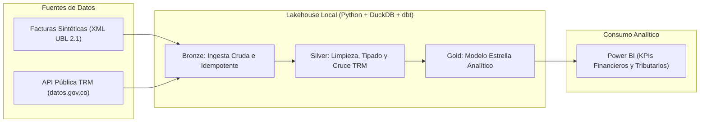

# dian-ubl-lakehouse

> **Estado del proyecto:** `En desarrollo - Fase 1: Arquitectura y Gobernanza`

Plataforma de datos *end-to-end* tipo Lakehouse local para el procesamiento analítico de facturación electrónica colombiana bajo estándar **DIAN UBL 2.1 (XML)** integrada con la **TRM oficial diaria (`datos.gov.co`)**, construida sobre arquitectura **Medallion**, **Python**, **DuckDB**, **dbt**, **Docker** y **Power BI**.

---

## 1. Objetivos del Proyecto

- **Objetivo de negocio:** Centralizar y estandarizar documentos de facturación electrónica multimoneda (COP/USD), homologando importes con la Tasa Representativa del Mercado (TRM) oficial diaria para habilitar análisis financiero, contable y tributario confiable (ventas netas, IVA, retenciones e impacto cambiario) en Power BI.
- **Objetivo técnico:** Implementar un Data Lakehouse local, reproducible, idempotente y de costo de infraestructura cero bajo arquitectura Medallion (*Bronze → Silver → Gold*), aplicando contratos/pruebas de calidad de datos en `dbt`, contenerización en `Docker` y automatización CI/CD en GitHub Actions.

---

## 2. Alcance y No-Alcance

### En Alcance (In-Scope)
- Generación determinista de facturas electrónicas **XML UBL 2.1 100 % sintéticas** con estructura fiscal colombiana realista.
- Ingesta resiliente e idempotente de archivos XML y de la API pública Socrata de **TRM (`datos.gov.co`)** hacia DuckDB.
- Transformación modular en **dbt** (*Silver* normalizada y *Gold* en esquema estrella) con pruebas automatizadas de integridad y calidad.
- Empaquetado reproducible con **Docker**, suite de pruebas con `pytest` y validaciones continuas en GitHub Actions.
- Modelo semántico y tablero ejecutivo en **Power BI**.

### Fuera de Alcance (Out-of-Scope)
- **Sin conexión a la DIAN:** No interactúa con los servicios web reales de validación previa, numeración ni emisión electrónica de la DIAN.
- **Sin firmas criptográficas reales:** No gestiona certificados digitales X.509 reales ni validación jurídica de CUFE ante autoridades fiscales.
- **Cero facturas reales o PII:** Jamás ingiere, almacena ni versiona documentos tributarios reales, NITs privados ni datos personales identificables (ver [SECURITY.md](SECURITY.md)).

---

## 3. Usuarios y Stakeholders del Repositorio

| Stakeholder | Interés Principal | Artefactos Clave |
| :--- | :--- | :--- |
| **Evaluador técnico** | Arquitectura Medallion, decisiones de diseño, calidad de código, testing, seguridad y reproducibilidad. | `docs/adr/`, `.github/`, `src/`, `dbt_project/`, `tests/` |
| **Usuario financiero / contable** | Conciliación multimoneda con TRM oficial, exactitud de subtotales/impuestos y KPIs ejecutivos. | Modelos *Gold* en `dbt_project/` y reportes en `bi/` |
| **Desarrollador / Data Engineer** | Ejecución local rápida, variables de entorno, linaje SQL en dbt y mantenimiento del pipeline. | `README.md`, `.env.example`, `src/`, `dbt_project/` |

---

## 4. Arquitectura Medallion

> El detalle de la elección tecnológica se documenta en [ADR 0001: Arquitectura Inicial y Stack](docs/adr/0001-initial-architecture-and-stack.md).

---

## 5. Hoja de Ruta (Milestones)

1. **Hito 1 — Arquitectura, Gobernanza y Seguridad *(Actual)*:** Estructura profesional del repositorio, controles de seguridad, plantillas de GitHub y ADR fundacional.
2. **Hito 2 — Generación Sintética e Ingesta Bronze:** Generador de facturas XML UBL 2.1 sintéticas, cliente REST para API TRM y carga cruda auditable en DuckDB.
3. **Hito 3 — Transformación Silver y Gold con dbt:** Parseo estructurado, conversión cambiaria con TRM, modelado dimensional (*Star Schema*) y pruebas `dbt test`.
4. **Hito 4 — Orquestación, Docker y CI/CD:** Ejecución unificada de extremo a extremo en contenedores y pipelines de verificación continua en GitHub Actions.
5. **Hito 5 — Capa BI y Entrega Ejecutiva:** Conexión del modelo *Gold* con Power BI, métricas DAX financieras/tributarias y documentación final de resultados.

---

## 6. Convenciones de Trabajo

### Estrategia de Ramas (GitHub Flow)
- **`main`:** Rama principal protegida; contiene únicamente estado estable y revisado.
- **Ramas de trabajo cortas:** Creadas desde `main` con prefijo descriptivo (`feat/`, `fix/`, `docs/`, `chore/`, `refactor/`, `test/`) e integradas exclusivamente vía **Pull Request**.

### Mensajes de Commit (Conventional Commits)
Formato estándar: `<tipo>(<alcance opcional>): <descripción breve en imperativo>`

- `feat`: nueva capacidad de ingesta, transformación o BI.
- `fix`: corrección de errores lógicos o de datos.
- `docs`: cambios en documentación o ADRs.
- `chore`: estructura base, dependencias o configuración de herramientas.
- `test`: adición o ajuste de pruebas unitarias y de calidad de datos.
- `ci`: flujos de trabajo en GitHub Actions.
